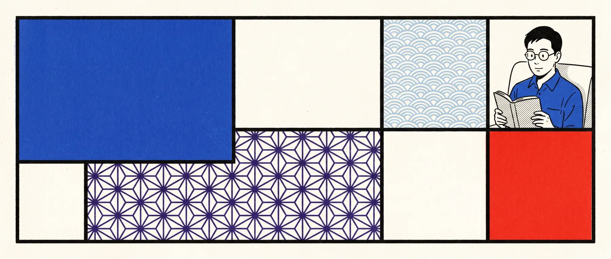

<div align="center">



# รัฐธรรมนูญ ในแบบที่ผมอยากให้คนอ่านจริง ๆ

**เว็บเรียนรัฐธรรมนูญฟรี สำหรับผู้สอบราชการไทย สร้างโดยคนที่เคยเจอปัญหานี้เอง แล้วหาว่าอะไรแ���้จะเรียนรู้ได้จริง**

**[เข้าไปอ่านเลย](https://constitution.nonarkara.org)** · [English](https://constitution.nonarkara.org)

</div>

---

## ถึงคนที่กำลังจะสอบอยู่ตอนนี้

คุณจะเหนื่อยมาก คุณจะเปิดเว็บนี้บนรถ หรือตอนตีสอง
หรือห้าสัปดาห์ก่อนสอบแล้วคิดว่า *"ควรเริ่มก่อนหน่านี้"*

ความคิดนั้นแพงกว่าที่เราคิดกัน มันทำให้เสียเวลาเตรียมตัวหลายเดือน
มากกว่าวิชาที่ยากที่สุดเสียอีก

ผมจะพูดสิ่งที่ไม่มีใครพูด:

**รอบแรกคุณจะตอบผิดเกือบทั้งหมด และนั่นคือสิ่งที่ออกแบบไว้**

เว็บนี้ไม่เริ่มด้วยการอธิบายอะไรคุณ
มันเริ่มจากการนั่งสอบจริง 80 หัวข้อโดยไม่ให้เปิดอะไรอ่านก่อน
คุณจะพลาดมาก แล้วทุกข้อที่พลาดจะยื่น **กุญแจ** — สิ่งที่ตัดสินคำตอบ — มาให้
แล้วถามข้อเดิมอีกครั้ง คุณจะไม่ผ่านไปจนกว่าจะตอบถูก

นี่ไม่ใช่กลวิธีชวนความรู้สึก
มันมาจากงานวิจัยจริง ๆ ว่าความทรงจำก่อตัวขึ้นอย่างไร
และมันคือการตัดสินใจข้อเดียวที่แยกเว็บนี้ออกจากกองไฟล์ค์แฟลชการ์ด

อ่านหัวข้อ [วงจรการเรียนรู้](#วงจรการเรียนรู้-หนึ่งความคิดห้าครั้ง) ก่อนตัดสินใจว่าจะใช้ยังไง
สี่นาที ประหยัดได้หลายสัปดาห์

---

## ทำไมถึงมีอยู่

ผมเป็นที่ปรึกษา ไม่ใช่นักกฎหมาย และไม่ใช่โปรแกรมเมอร์
ผมเคยเห็นคนจำนวนมากเตรียมสอบ และเคยเห็นตัวเองเตรียมผิดวิธีไปด้วย

สิ่งที่เจอคือ คนส่วนใหญ่เรียนรัฐธรรมนูญเหมือนเรียนประวัติศาสตร์
อ่านบท ไฮไลต์ประโยคสำคัญ รู้สึกดี แล้วสอบได้ไม่ดี

สามอย่างผิด และเว็บนี้คือคำตอบของแต่ละอย่าง

### 1. การอ่านไม่ใช่การเรียน

การไฮไลต์ให้ความรู้สึกว่าเราทำงาน เพราะมันใช้แรง
และนั่นแหละคือเหตุผลว่ามันไม่ใช่หลักฐานว่าเราเรียนรู้
งานวิจัยหลายทศวรรษตรงกันว่า **การทดสอบตัวเองและการเว้นระยะ** ชนะการอ่านซ้ำ
หรือการไฮไลต์อย่างชัดเจน ส่วนการอธิบาย การสลับเรื่อง และการใช้ภาพ
ช่วยได้แต่ขึ้นกับงานและผู้เรียน
([Dunlosky et al., 2013](https://www.psychologicalscience.org/publications/journals/pspi/learning-techniques.html))
ผลของการเว้นระยะเป็นเรื่องที่มีหลักฐานมั่นคง
([Cepeda et al., 2006](https://www.psychologicalscience.org/publications/journals/pspi/spacing.pdf))
และมีงานทบทวนใหม่กว่าเรื่องโครงสร้างของการดึงความรู้คืนมา
([Carpenter et al., 2022](https://www.nature.com/articles/s44159-022-00089-1))

สรุปคือ ทุกข้อที่นี่คือการสอบ การตอบข้อสอบคือการเรียนรู้

### 2. คำตอบที่ผิดคือข้อมูลที่มีค่าที่สุดในห้อง

แอปส่วนใหญ่มองคำตอบผิดว่าเป็นการลงโทษ ทำให้ตัวเลขแดง แล้วเดินต่อ
นั่นคือการทิ้งข้อมูลที่ดีที่สุดในห้องไปเปล่า ๆ

ที่นี่ คำตอบผิดกลายเป็น **หนี้** มันจะกลับมาจนกว่าคุณตอบถูก
ไม่ใช่จนกว่าคุณจำประโยคได้ และไม่ใช่จนกว่าคุณแตะสองรอบ
แต่จนกว่าคุณ **ตัดตัวเลือกที่เหลือออกได้ด้วยเหตุผล**
ทักษะนั้นคือสิ่งที่ข้อสอบวัด และเป็นสิ่งเดียว

### 3. กุญแจย้ายไปใช้ได้ ประโยคย้ายไม่ได้

ถ้าจำว่า *"มาตรา 213 ต้องไปผู้ตรวจการแผ่นดินก่อน"* ก็ช่วยได้แค่ข้อเดียว
แต่ถ้าเข้าใจว่า *"เรื่องนี้ต้องไปหน่วยงานบริหารก่อนถึงจะถึงศาล และต้องเงียบไป 60 วัน"* กุญแจนี้ตอบได้ทั้งมาตรา 213 และข้อถัดไปที่หน้าตาแบบเดียวกัน

ทุกข้อใน Pokklong 284 ข้อ และข้อสอบจำลอง 90 ข้อ มี **กุญแจ** เขียนไว้ข้าง ๆ คำอธิบาย
และมีเทสต์บังคับว่าไม่มีสองข้อไหนใช้กุญแจเดียวกัน
เพราะกุญแจที่ถูกคัดลอก คือกุญแจที่ใช้ได้แค่ครั้งเดียว

---

## วงจรการเรียนรู้: หนึ่งความคิดห้าครั้ง

นี่คือทั้งผลิตภัณฑ์ อย่างอื่นคือทางที่จะมาถึงมัน

```svg
<svg viewBox="0 0 860 260" xmlns="http://www.w3.org/2000/svg" role="img"
     aria-label="วงจรการเรียนรู้ สอบโดยไม่อ่าน ตอบผิด ได้กุญแจ ตอบอีกครั้ง ผ่านแล้ว">
  <style>
    .box { fill: none; stroke: #111; stroke-width: 2; }
    .lbl { font-family: system-ui, sans-serif; font-size: 14px; fill: #111; }
    .lbl-w { font-family: system-ui, sans-serif; font-size: 14px; fill: #fff; }
    .num { font-family: ui-monospace, monospace; font-size: 13px; fill: #111; }
  </style>

  <rect class="box" fill="#E4002B" x="10" y="40" width="150" height="96"/>
  <text class="lbl-w" x="85" y="72" text-anchor="middle">สอบเปล่า</text>
  <text class="lbl-w" x="85" y="94" text-anchor="middle">80 หัวข้อ</text>
  <text class="lbl-w" x="85" y="114" text-anchor="middle">ไม่มีอะไรให้อ่าน</text>
  <text class="num" x="16" y="30">01</text>

  <line x1="160" y1="88" x2="205" y2="88" stroke="#111" stroke-width="2"/>
  <polygon points="205,88 195,83 195,93" fill="#111"/>
  <rect class="box" x="207" y="40" width="150" height="96"/>
  <text class="lbl" x="282" y="72" text-anchor="middle">คุณตอบผิด</text>
  <text class="lbl" x="282" y="94" text-anchor="middle">ส่วนใหญ่</text>
  <text class="lbl" x="282" y="114" text-anchor="middle">นั่นคือจุดประสงค์</text>
  <text class="num" x="213" y="30">02</text>

  <line x1="357" y1="88" x2="402" y2="88" stroke="#111" stroke-width="2"/>
  <polygon points="402,88 392,83 392,93" fill="#111"/>
  <rect class="box" fill="#F5C518" x="404" y="40" width="180" height="96"/>
  <text class="lbl" x="494" y="70" text-anchor="middle">ได้กุญแจ</text>
  <text class="lbl" x="494" y="92" text-anchor="middle">สิ่งที่ตัดสิน</text>
  <text class="lbl" x="494" y="112" text-anchor="middle">คำตอบได้</text>
  <text class="num" x="410" y="30">03</text>

  <line x1="584" y1="88" x2="629" y2="88" stroke="#111" stroke-width="2"/>
  <polygon points="629,88 619,83 619,93" fill="#111"/>
  <rect class="box" fill="#0057B7" x="631" y="40" width="150" height="96"/>
  <text class="lbl-w" x="706" y="72" text-anchor="middle">ตอบอีกครั้ง</text>
  <text class="lbl-w" x="706" y="94" text-anchor="middle">ตัดที่เหลือ</text>
  <text class="lbl-w" x="706" y="114" text-anchor="middle">ด้วยเหตุผล</text>
  <text class="num" x="637" y="30">04</text>

  <rect x="700" y="170" width="150" height="52" fill="#111"/>
  <text x="775" y="202" text-anchor="middle" font-family="system-ui,sans-serif"
        font-size="16" fill="#fff">ผ่านแล้ว →</text>

  <path d="M 85 136 L 85 196 Q 85 208 97 208 L 620 208 Q 632 208 632 196 L 632 140"
        fill="none" stroke="#111" stroke-width="2" stroke-dasharray="6 5"/>
  <polygon points="632,136 627,146 637,146" fill="#111"/>
  <text x="358" y="228" text-anchor="middle" font-family="ui-monospace,monospace"
        font-size="13" fill="#111">ผิดอีก → กุญแจยังอยู่ แล้วข้อนี้จะกลับมา</text>

  <text x="10" y="250" font-family="system-ui,sans-serif" font-size="13" fill="#555">
    ข้อจะเสร็จเมื่อคุณเห็นคำตอบ ไม่ใช่เมื่อคุณเข้าใจมัน
  </text>
</svg>
```

อ่านบรรทัดล่างอีกครั้ง นี่คือข้อโต้แย้งทั้งหมดของโครงการนี้

---

## มีอะไรอยู่ข้างใน

| | |
|---|---|
| **279 มาตรา** | รัฐธรรมนูญฉบับเต็ม พ.ศ. 2560 รวมแก้ไข พ.ศ. 2564 ไทยเป็นหลัก อังกฤษจากสภานิยมธรรม และคำแปลศึกษาภาษาจีน |
| **837 เสียง** | ทุกมาตราอ่านครบทั้งสามภาษา สร้างในเครื่อง และตรวจ checksum กับต้นฉบับ |
| **470 ข้อ** | ข้อฝึกเขียนขึ้นจากตัวบท พร้อมคำอธิบายและที่มา |
| **284 ข้อ Pokklong** | บันไดสิบสองขั้น ผ่านกฎหมายการปกครองท้องถิ่น |
| **90 หัวข้อสอบจำลอง** | หัวข้อประเมินของข้อสอบนายอำเภอ มีกุญแจทุกข้อ |
| **13 บทคู่มือ** | สิบสามบทที่สอนเหตุผล ไม่ใช่รายการ |
| **ใช้ออฟไลน์ได้** | ติดตั้งได้ ไม่ต้องมีบัญชี ไม่ติดตาม ข้อมูลอยู่ในเครื่องคุณ |

---

## Pokklong: สิบสองขั้น

คนส่วนใหญ่ที่พยายามเรียน *ปกครอง* จะจำเลขมาตรา
อันนี้ทำตรงข้าม มันสร้างตรรกะจากฐานขึ้นมาทีละขั้น
โดยแต่ละขั้นใช้แค่ขั้นก่อนหน้า

```svg
<svg viewBox="0 0 860 300" xmlns="http://www.w3.org/2000/svg" role="img"
     aria-label="สิบสองขั้นของ Pokklong ตั้งแต่ทำไมรัฐต้องมีฝ่ายปกครอง จนถึงการตรวจสอบและความรับผิด">
  <style>
    .s { stroke:#111; stroke-width:2; }
    .t { font-family: system-ui, sans-serif; font-size:13px; fill:#111; }
    .n { font-family: ui-monospace, monospace; font-size:12px; fill:#111; }
  </style>
  <g>
    <rect class="s" fill="#E4002B" x="10"  y="20"  width="130" height="80"/>
    <rect class="s" fill="#fff"    x="150" y="20"  width="130" height="80"/>
    <rect class="s" fill="#0057B7" x="290" y="20"  width="130" height="80"/>
    <rect class="s" fill="#F5C518" x="430" y="20"  width="130" height="80"/>
    <rect class="s" fill="#fff"    x="570" y="20"  width="130" height="80"/>
    <rect class="s" fill="#111"    x="710" y="20"  width="130" height="80"/>
    <rect class="s" fill="#fff"    x="10"  y="110" width="130" height="80"/>
    <rect class="s" fill="#F5C518" x="150" y="110" width="130" height="80"/>
    <rect class="s" fill="#fff"    x="290" y="110" width="130" height="80"/>
    <rect class="s" fill="#0057B7" x="430" y="110" width="130" height="80"/>
    <rect class="s" fill="#fff"    x="570" y="110" width="130" height="80"/>
    <rect class="s" fill="#E4002B" x="710" y="110" width="130" height="80"/>
  </g>
  <text class="n" x="16"  y="14">01</text><text class="t" x="16"  y="46">ทำไมรัฐ</text><text class="t" x="16"  y="66">ต้องมีฝ่าย</text><text class="t" x="16"  y="84">ปกครอง</text>
  <text class="n" x="156" y="14">02</text><text class="t" x="156" y="46">สามส่วน</text><text class="t" x="156" y="66">ของราชการ</text>
  <text class="n" x="296" y="14">03</text><text class="t" x="296" y="46">ส่วนกลาง</text><text class="t" x="296" y="66">ใครหัวหน้าใคร</text>
  <text class="n" x="436" y="14">04</text><text class="t" x="436" y="46">จังหวัด</text><text class="t" x="436" y="66">และอำเภอ</text>
  <text class="n" x="576" y="14">05</text><text class="t" x="576" y="46">ปกครอง</text><text class="t" x="576" y="66">ตนเอง</text>
  <text class="n" x="716" y="14">06</text><text class="t" x="716" y="46">สายบังคับ</text><text class="t" x="716" y="66">บัญชา</text>
  <text class="n" x="16"  y="104">07</text><text class="t" x="16"  y="136">คำสั่งกับ</text><text class="t" x="16"  y="154">กฎ</text>
  <text class="n" x="156" y="104">08</text><text class="t" x="156" y="136">ใครออก</text><text class="t" x="156" y="154">คำสั่งได้</text>
  <text class="n" x="296" y="104">09</text><text class="t" x="296" y="136">กระบวนการ</text><text class="t" x="296" y="154">เป็นธรรม</text>
  <text class="n" x="436" y="104">10</text><text class="t" x="436" y="136">อุทธรณ์</text><text class="t" x="436" y="154">เพิกถอน</text>
  <text class="n" x="576" y="104">11</text><text class="t" x="576" y="136">บังคับการ</text><text class="t" x="576" y="154">และการแจ้ง</text>
  <text class="n" x="716" y="104">12</text><text class="t" x="716" y="136">ตรวจสอบ</text><text class="t" x="716" y="154">ความรับผิด</text>

  <text x="10" y="228" font-family="system-ui,sans-serif" font-size="14" fill="#111" font-weight="600">
    ทายก่อน แล้วดูว่าทำไม แล้วดูตรรกะที่สะสมมาถึงตอนนี้
  </text>
  <text x="10" y="252" font-family="system-ui,sans-serif" font-size="13" fill="#555">
    แต่ละขั้นเพิ่มความคิดหนึ่งอย่างเข้าไปในสรุปที่โตขึ้นเรื่อย ๆ
  </text>
  <text x="10" y="270" font-family="system-ui,sans-serif" font-size="13" fill="#555">
    ถึงขั้นที่ 12 คุณประกอบตรรกะราชการไทยขึ้นมาใหม่ได้ ไม่ต้องจำเลขมาตรา
  </text>
</svg>
```

**ที่มา และหลัก "หยิบ ปรับ เครดิต"**
รายการหัวข้อและนิสัยว่าชอบถามตัวเลขกับกำหนดเวลามาจาก
*แนวข้อสอบ พ.ร.บ.วิธีปฏิบัติราชการทางปกครอง พ.ศ. 2539* ของประพันธ์ เวารัมย์
ทุกข้อถูกเขียนใหม่ **ไม่ได้คัดมาแบบตรงตัว**
และตรวจตัวบทกับวิกิซอร์สไทยแล้ว
เรายังแก้คำตอบผิดในต้นทางตาม `source/slideshare-2539-INDEX.md`
และเติมสองเรื่องที่ต้นทางไม่มีเลย คือโครงสร้างของรัฐ
และการตรวจสอบตาม พ.ร.บ. ละเมิดสิทธิ 2539 และ พ.ร.บ. ข้อมูลข่าวสารราชการ 2540

นั่นคือจริยธรรมทั้งหมดของโครงการนี้ เอาโครงสร้างที่ดี
แก้ข้อผิดพลาด และบอกว่ามาจากไหน

---

## จิตวิทยา และผมได้มาจากไหน

ผมไม่ใช่นักจิตวิทยา และสิ่งต่อไปนี้ไม่ใช่ผลการวิจัยของผม
คือสิ่งที่ผมอ่าน สิ่งที่ผมเชื่อว่ามีเหตุผล
และการตัดสินใจเฉพาะในโค้ดแต่ละข้อที่ออกมาจากมัน
รวมถึงจุดที่ผม **เลือกไม่ทำตาม**

| แนวคิด | มันบอกว่าอะไร | มันเปลี่ยนอะไรในเว็บนี้ |
|---|---|---|
| **ผลของการทดสอบ** (retrieval practice) | ดึงออกมาจากความทรงจำได้เสริมกว่าที่ใส่เข้าไป | ทุกข้อคือการสอบก่อน คำอธิบายมาหลังคำตอบเสมอ ไม่ใช่ก่อน |
| **ผลของการเว้นระยะ** (Cepeda 2006) | ทบทวนกระจายหลายวัน ชนะอ่านรวบยอด | ข้อที่ตกไปจะกลับมาที่ 10 นาที แล้ว 1, 3, 7 และ 14 วัน |
| **จัดอันดับประสิทธิผล** (Dunlosky 2013) | ทดสอบตนเองกับเว้นระยะคือประสิทธิผลสูง อ่านซ้ำกับไฮไลต์คือต่ำ | ตัดการไฮไลต์และการอ่านซ้ำออกจากผลิตภัณฑ์ทั้งหมด |
| **ผลขึ้นกับงาน** (Carpenter 2022) | การอธิบาย การสลับ และภาพ ช่วยได้ต่างกันตามงานและผู้เรียน | มีให้เลือก แต่ไม่เคยอ้าง ตัวเว็บไม่อ้างผลกับคุณ |
| **เรียกคืนก่อนเห็นตัวเลือก** | พยายามนึกก่อนเลือก ชนะเลือกโดยไม่นึก | คุณนึกก่อน แล้วค่อยเห็นตัวเลือก ข้ามได้ แต่ค่าเริ่มต้นคือเปิดไว้ |
| **ความยากลำบากที่พอดี** (desirable difficulty) | ความลำบากเล็กน้อยตอนที่ถูกที่ ซื้อความง่ายในภายหลังได้มาก | ข้อสอบจำลองไม่ให้อ่านล่วงหน้า ความเสียดสีตรงนี้คือฟีเจอร์ |

### สิ่งที่ผมเลือกไม่อ้าง

- ตาราง **1/3/7/14 วัน** เป็นจุดเริ่มต้น ไม่ใช่ค่าที่ดีที่สุด ไม่มีใครพิสูจน์ว่าเหมาะกับคุณ
- แอป **ไม่ตรวจให้คะแนน**คำอธิบายที่คุณเขียน มันเก็บและแสดงกลับมาให้คุณเท่านั้น
  ปัญญาประดิษฐ์ที่แก้เหตุผลซึ่งตัวเองประเมินไม่ได้ เป็นครูที่แย่กว่าการเงียบ
- ที่นี่ **ไม่มีโค้ชเอไอ** ไม่มีโมเดลไหนตรวจคุณ ไม่มีการเก็บความคิดเห็นทางการเมือง
  ทุกอย่างทำงานในเบราว์เซอร์ของคุณ นี่คือการฝึกความจำแบบปรับตัว
  ไม่ใช่ระบบที่ฝึกมา และไม่ใช่คำกล่าวอ้างเรื่องความคิดเห็นของคุณ
- **ผลของเว็บนี้ต่อคะแนนสอบของคุณยังไม่ถูกทดสอบ**
  ผมไม่ได้ทำงานวิจัยแบบควบคุม ที่ผมมีคือเหตุผลกับชุดเทสต์

---

## ผมเรียนรู้เรื่องพวกนี้ยังไง

ไม่ใช่ในห้องเรียน ผมเป็นที่ปรึกษา ทำงานกับลูกค้าเรื่องกลยุทธ์และองค์กร
ไม่ใช่กฎหมาย ทุกอย่างที่อยู่ตรงนี้มาจากความอยากรู้ที่ผิดลำดับ

ผมเรียนรู้สิ่งส่วนใหญ่แบบที่ผมเคยเรียนทุกอย่าง ผิดก่อน แล้วค่อยมาถูก
ผมอ่านรัฐธรรมนูญรอบเดียว ไฮไลต์หนัก ๆ แล้วสอบได้แย่กว่าคนที่แค่ทำข้อสอบเก่าสามสัปดาห์
รอยห่างนั้นน่าอายพอจะน่าสนใจ ถ้าความพยายามให้ความรู้สึกว่าเดินหน้า
แต่ไม่ได้ผลอะไรเลย แปลว่าความพยายามไม่ใช่กลไก และผมต้องหาว่าอะไรคือกลไก

ผมจึงไปอ่านงานวิจัยจริง ๆ ไม่ใช่เพราะชอบอ่าน
แต่เพราะค่าของการผิดพลาดสี่เดือนสูงกว่าค่าของบ่ายที่อึดอัดกับงานวรรณกรรมมาก
retrieval practice, spacing, desirable difficulty
พอเห็นว่าผลมันจริงและใหญ่ การอ้างว่า *"อ่านโน้ตซ้ำก็พอ"* ก็เลิกเป็นข้อแก้ตัวได้แล้ว

บางอย่างมาจากที่อื่น ผมชอบเรียนระบบมากกว่าข้อเท็จจริง
คุณชื่นมอง Championship Manager หรือเล่นเกมฟุตบอลยี่สิบห้าปีโดยไม่สังเกตว่ามันเป็นเรื่องของ
การค้นหา การดู และความน่าจะเป็นล้วน ๆ ไม่ใช่พรสวรรคต
การเห็นทีมที่ดีชนะเกมที่ควรแพ้ สอนอะไรชัดเท่างานวรรณกรรมหนึ่งฉบับ
พวกเขารู้อะไรที่คู่แข่งไม่รู้ และรู้ได้ทันหรือเปล่า นั่นคือคำถามข้อสอบพอดี
องค์กรไหนทำอะไรได้ และใครมีอำนาจอนุมัติ

ส่วนหนึ่งเรียนรู้จากการทำพลาด เว็บรุ่นแรกของผมเป็นกองไฟล์ค์แฟลชการ์ด
เพราะไฟล์ค์แฟลชการ์ดคือสิ่งที่ผมใช้เสมอ มันไม่ได้ผล มันถูกแทนที่เพราะข้อมูลไม่ยืนยันมัน
ไม่ใช่เพราะมันดูไม่ดี ผมยอมลบฟีเจอร์ที่ผมชอบ มากกว่าเก็บฟีเจอร์ที่โต้แย้งไม่ได้

### ที่ผมยังผิด

ผมเป็นที่ปรึกษาที่เขียนเรื่องกฎหมาย อ่านตัวบทอย่างรอบคอบแล้ว
และทุกบทถูกตรวจกับต้นฉบับไทยโดยคนที่ไม่ได้ทำงานให้ผม
แต่ **นี่ไม่ใช่คำแนะนำกฎหมาย ไม่ใช่หลักสูตรอย่างเป็นทางการ
และพิมพ์ผิดในระบบกฎหมายแย่กว่าพิมพ์ผิดในเมนูมาก** ทุกหน้ามีที่มาและวันที่
ถ้ามันไม่ตรงกับราชกิจจานุเบกษา ราชกิจจานุเบกษาชนะ และช่วยบอกผมด้วย

---

## มันสร้างยังไง

Next.js export แบบ static เสิร์ฟจาก Cloudflare Worker
ไม่มี backend ไม่มีบัญชี ไม่มี analytics ไม่มีการติดตาม
ติดตั้งลงหน้าจอหลักได้ และใช้ได้ตอนไม่มีเน็ต

```
app/          เส้นทาง — ทุกหน้าเป็น static HTML
components/   ส่วนที่โต้โตรได้
lib/          เข้าถึงคลังข้อมูล โมเดลการเรียนรู้ การนำทาง
data/         รัฐธรรมนูญ ข้อความสอบ คู่มือ — JSON ล้วน ๆ
scripts/      ตัวตรวจ ขั้นตอน build และประตูของการปล่อยเวอร์ชัน
tests/        164 เทสต์ คลังข้อมูล ข้อความ คำแปล คดี และ UI
```

กฎการออกแบบสองข้อที่บังคับใช้จริง ไม่ใช่แค่ตั้งใจ

**ทุกตัวเลขต้องมีหลักฐานจากตัวบท** เทสต์เดินทุกรายการในกระดาษรวบยอด 41 รายการ
และยืนยันว่าอันที่อ้างอิงก็ตรงกับวลีในภาษาไทยของมาตรานั้นจริง
ถ้ากำหนดเวลาผิด build จะหยุด

**ทุกข้อความต้องมีที่มา** ตัวเลขและข่าวมีแหล่งที่มาและวันที่ดึงมา
ที่แหล่งขัดกัน หน้าเว็บจะบอกว่าขัดกัน ไม่ใช่เลือกอันที่สะดวกกว่า

### ประตูของการปล่อยเวอร์ชัน

ปล่อยเวอร์ชันไม่ได้แปลว่า "คอมไพล์ผ่าน"

```bash
npm run release   # ตรวจ → เทสต์ → build → ไฟล์ที่ generate ผิด → ลิงก์ สี คอนทราสต์
```

- **ไฟล์ที่ generate แล้วล้าสมัย** — build สร้าง `data/*.json` 4 ไฟล์ใหม่ที่ถูก commit ไว้
  ถ้าไม่ตรงกับ build ใหม่ แปลว่า commit นั้นส่ง index ที่ล้าสมัย
- **ความถูกต้องของลิงก์** — ทุกลิงก์ภายในในทุกหน้าที่ build รวมถึง sitemap และทั้งสามฟีดพอดแคสต์
  ต้อง resolve ได้
- **โทเคนสีที่ไม่ถูกนิยาม** — `var(--x)` ที่ไม่มีธีมไหนนิยาม จะ fallback เงียบ ๆ
  ซึ่งเคยทำให้กระดาษรวบยอดนั่งที่ 2.47:1 ในโหมดมืด
- **คอนทราสต์แยกตามชั้นของ WCAG** — ข้อความ 4.5:1 เส้นขอบส่วนประกอบ 3:1 เส้นตกแต่งรายงานไม่ตัดสิน
  เกณฑ์เดียวสำหรับทั้งหมดทำให้เกิด false failure บนเส้นขอบและพลาดข้อความจริง
- **เส้นทางที่ redirect ถูกประกาศ ไม่ใช่เดา** — หน้าที่ redirect ผ่านการตรวจว่ามีไฟล์ทุกข้อ
  แต่ไม่มีประโยชน์กับการทำดัชนี จึงมี `REDIRECT_ROUTES` ใน `lib/nav.ts`
  บอกว่าอันไหนคือ และประตูจะ fail ถ้ามันหลุดไปโผล่ใน sitemap

---

## รันเอง

```bash
git clone https://github.com/Nonarkara/constitution.git
cd constitution
npm ci
npm run dev        # http://localhost:3000
npm run release    # ประตูทั้งหมด
```

ต้องใช้ Node 24 ขึ้นไป ไม่ต้องใช้ API key ไม่ต้องมีฐานข้อมูล ไม่ต้องมีบัญชี

---

## สัญญาอนุญาตและที่มา

โค้ดเปิดภายใต้ **MIT License** ดูที่ [LICENSE](LICENSE)

ตัวรัฐธรรมนูญเป็นเอกสารสาธารณะ ภาษาไทยเป็นหลัก
ฉบับภาษาอังกฤษเป็นของสภานิยมธรรม มีการแก้ไขเพื่อการศึกษากำกับไว้ทุกหน้า
ภาษาจีนเป็นคำแปลเพื่อการศึกษาและระบุไว้ชัดเจน

เสียงประกอบเป็นเสียงสังเคราะห์ สร้างในเครื่องจากภาษาไทยและตรวจ checksum กับต้นฉบับ
ไม่ใช่เสียงบันทึกของสภานิยมธรรม ซึ่งเชื่อมไว้แยกต่างหากและเก็บภายใต้เงื่อนไขของตัวเอง

โครงสร้างหัวข้อของ Pokklong เครดิตชุดข้อสอบ พ.ศ. 2539 ของประพันธ์ เวารัมย์
ตามที่กล่าวไว้ข้างต้น คือ เขียนใหม่ แก้ข้อผิดพลาด และระบุที่มา

อ้างอิงงานวิจัย: [Dunlosky et al. 2013](https://www.psychologicalscience.org/publications/journals/pspi/learning-techniques.html) ·
[Cepeda et al. 2006](https://www.psychologicalscience.org/publications/journals/pspi/spacing.pdf) ·
[Carpenter et al. 2022](https://www.nature.com/articles/s44159-022-00089-1)

---

<div align="center">

**โชคดีนะ ตอบผิดรอบแรก นั่นแหละคือส่วนที่ได้ผล**

สร้างโดย [ดร.นนท์ อร์การประสกษ์](https://constitution.nonarkara.org/research)
และตัวแทนจำนวนน้อยที่ถูกสั่งให้ตรวจเขา

</div>